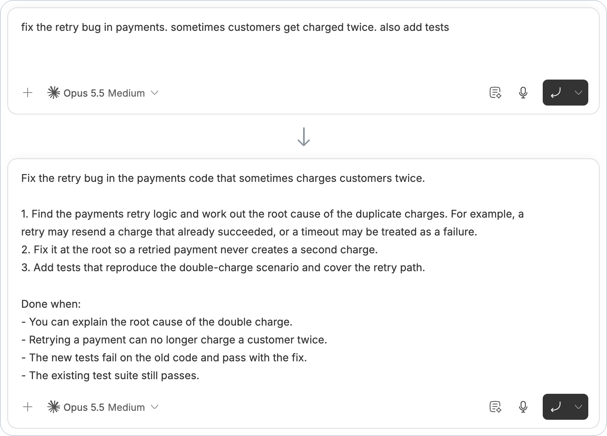
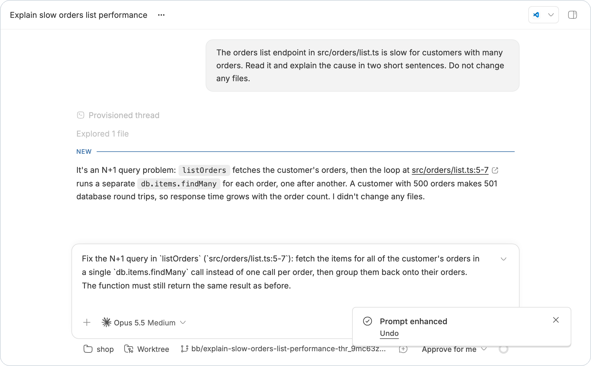
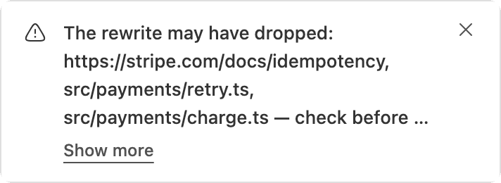
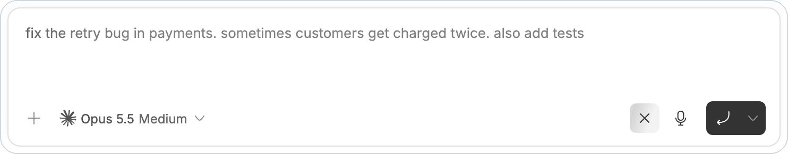
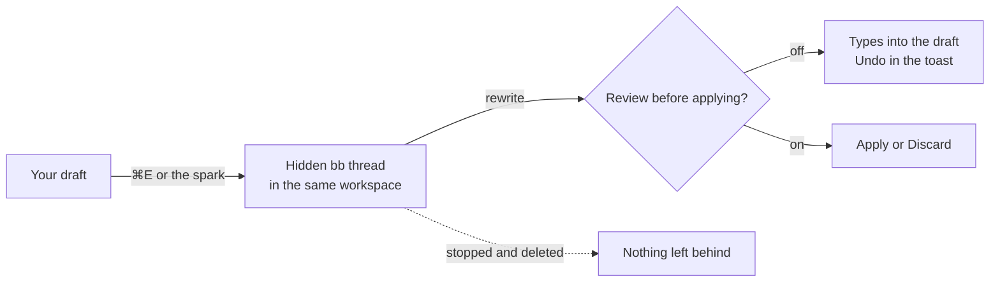
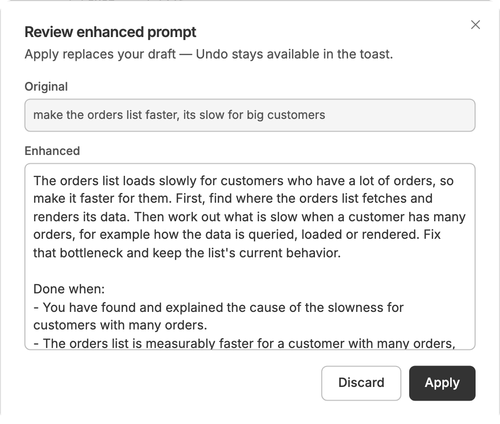
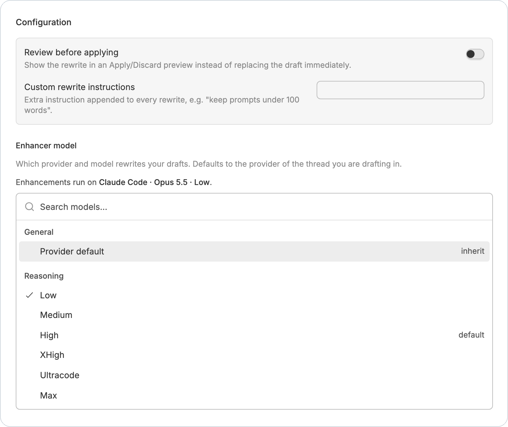

<h1 align="center">Prompt Enhancer</h1>

<p align="center"><b>Turn a rough draft into a prompt worth sending, right in the <a href="https://getbb.app">bb</a> composer you are typing in.</b><br>The rewrite runs in a hidden bb thread on the provider you already use. No API keys, no external service.</p>

<p align="center">
<a href="https://github.com/vburojevic/bb-plugin-prompt-enhancer/releases/latest"></a>

<a href="LICENSE"></a>
<a href="https://github.com/get-bb/marketplace"></a>
</p>

<picture>
  <source media="(prefers-color-scheme: dark)" srcset="assets/screenshots/hero-dark.png">
  
</picture>

## Install

Prompt Enhancer is listed in the [BB Community marketplace](https://github.com/get-bb/marketplace), so bb installs it by name:

```sh
bb plugin install prompt-enhancer
```

Then click the spark in any composer, or press <kbd>⌘</kbd> <kbd>E</kbd> (<kbd>Ctrl</kbd> <kbd>E</kbd> on Windows and Linux) while the composer is focused.

> [!TIP]
> You can also find it inside bb under **Settings → Plugins**, or install straight from git. bb git installs take an explicit ref, so pin a release if you prefer:
>
> ```sh
> bb plugin install git:https://github.com/vburojevic/bb-plugin-prompt-enhancer.git@main
> bb plugin install git:https://github.com/vburojevic/bb-plugin-prompt-enhancer.git@v0.2.6
> ```

> [!NOTE]
> Releases after v0.2.6 need bb 0.49 or later. bb skips releases your bb cannot run, so an older bb stays on v0.2.6 until you update it.

## It picks the shape from the draft

The rewriter is not told "make it longer". It reads the draft and chooses: a simple ask stays roughly one line, and only real multi-part work earns a brief with a `Done when:` list. That is what keeps it useful on every message, not only the first one.

| You type | You get |
| --- | --- |
| `fix the retry bug in payments. sometimes customers get charged twice. also add tests` | A brief with the goal restated precisely, the steps to take, and a `Done when:` list (the image above) |
| `ok fix that in our code` | One sharpened line, still one line |

## Follow-ups know where they are

A draft written mid-conversation is a follow-up. The agent already holds the context, so inflating it into a standalone spec would reopen settled ground. The plugin detects that case and tells the rewriter to keep it a follow-up.

It also passes the thread title and the tail of the last assistant message, used **only** to resolve vague references. Here `that` becomes the N+1 query the agent just described, and the result stays short:

<picture>
  <source media="(prefers-color-scheme: dark)" srcset="assets/screenshots/follow-up-dark.png">
  
</picture>

## Your references survive

`@mentions`, file paths, identifiers, code spans, shell commands, URLs and quoted strings are live references, not prose. The rewriter is told to carry every one of them through untouched. Here both paths and the link come out the other side intact, while everything around them gets sharper:

```text
fix the double charge bug in src/payments/retry.ts and src/payments/charge.ts,
follow https://stripe.com/docs/idempotency and add a test
```

```text
Fix the double-charge bug in `src/payments/retry.ts` and `src/payments/charge.ts`
by implementing idempotent request handling per Stripe's idempotency key
guidance (https://stripe.com/docs/idempotency), so retried charge attempts do
not create duplicate charges. Add a test covering the retry-causes-duplicate-
charge scenario to confirm the fix.
```

@-mention pills stay pills. The rewrite is written back with each pill placed on its text in the new draft, so a mention still opens its file after an enhance, an Undo, or a run picked up after a reload.

Then the plugin **checks**, because "told to" is not "did". It extracts every reference from your original again and verifies each one survived. It uses the composer's structured `@`-mentions as ground truth rather than guessing from the text, and warns you before you send.

<table>
<tr>
<td width="50%" valign="top">

<picture>
  <source media="(prefers-color-scheme: dark)" srcset="assets/screenshots/references-dark.png">
  
</picture>

</td>
<td width="50%" valign="top">

Here a `Rewrite in at most 5 words.` custom instruction squeezed both file paths and the link out of the rewrite. The guard named all three before anything was sent.

Attachments are counted and declared to the rewriter too, so it never invents or drops a reference to a file it cannot see.

</td>
</tr>
</table>

## Nothing is lost while it runs

<picture>
  <source media="(prefers-color-scheme: dark)" srcset="assets/screenshots/running-dark.png">
  
</picture>

While a rewrite is in flight the draft locks and shimmers: one highlight band sweeps the whole draft, anchored to the viewport so it stays a single band however the editor splits your text into spans. The spark becomes a cancel button.

A run belongs to the **composer draft, not to the screen**. Leave the thread mid-rewrite and it keeps going. Come back and it is still there: still shimmering if it is running, typing itself in if it finished while you were away. The same holds across a window reload, a plugin reload and a second window, because the server looks a run up by composer scope instead of the tab remembering it.

Nothing ends a run except you cancelling it or the server giving up after 190 seconds. The predicted duration only paces the animation: a rewrite that runs long is waited out, not reaped. The prediction adapts per model from recent measured completions rather than a flat 90-second ceiling, so a fast model fails fast and a slow one gets room.

When the rewrite lands, the toast offers **Undo** to restore your original draft, pills included.



The hidden thread runs in the workspace you are drafting in: the thread's own environment, or the project's checkout in the new-thread composer. It may read files to resolve what the draft refers to, but it is told never to edit files, run commands or carry out the draft. It creates no worktree and no branch, and it is stopped and deleted the moment it resolves, so nothing piles up in your thread list or your repository.

## Review before applying, and choose the model

<table>
<tr>
<td width="50%" valign="top">

<picture>
  <source media="(prefers-color-scheme: dark)" srcset="assets/screenshots/review-dark.png">
  
</picture>

### Review before applying

Prefer to look before it touches your draft? Turn on **Review before applying** and every rewrite arrives in an Apply/Discard preview showing both versions, with the dropped-reference warning inline if there is one.

</td>
<td width="50%" valign="top">

<picture>
  <source media="(prefers-color-scheme: dark)" srcset="assets/screenshots/settings-dark.png">
  
</picture>

### Choose what rewrites your drafts

By default the rewrite runs on the provider of the thread you are drafting in (or the project default in the new-thread composer), at that provider's default model.

Pin something else under **Settings → Prompt Enhancer**. Picking a model shows its reasoning levels in their own group, the same progressive disclosure bb's own model picker uses. It lives in settings rather than beside the draft because it is a set-once preference: the composer keeps a single button.

</td>
</tr>
</table>

**Custom rewrite instructions** appends a standing instruction to every rewrite: `keep prompts under 100 words`, `always write in German`, whatever you keep asking for.

<details>
<summary><b>Settings from the CLI</b></summary>

<br>

Both settings are also reachable from the CLI:

```sh
bb plugin config prompt-enhancer
bb plugin config prompt-enhancer set previewBeforeApply true
bb plugin config prompt-enhancer set customInstructions "keep prompts under 100 words"
```

| Setting | Key | Default |
| --- | --- | --- |
| Review before applying | `previewBeforeApply` | off |
| Custom rewrite instructions | `customInstructions` | empty |

The enhancer model is chosen in **Settings → Prompt Enhancer** only.

</details>

<details>
<summary><b>Details</b></summary>

<br>

- **Motion:** every animation collapses to an instant text swap under `prefers-reduced-motion`.
- **Long drafts:** the draft is capped at 8000 characters in the rewrite prompt, and custom instructions at 500, so they can't dominate it.
- **Language:** the rewrite stays in the language the draft was written in.
- **Enhance while busy:** you can enhance a draft while the agent is still running its previous turn.
- **Touch:** on a phone the composer action grows to the same 36x40 target bb's own composer buttons use, and the review step opens as a bottom sheet instead of a centered dialog.
- **Shortcut:** <kbd>⌘</kbd> <kbd>E</kbd> or <kbd>Ctrl</kbd> <kbd>E</kbd> starts a rewrite while the composer is focused, and the spark's tooltip shows it.

</details>

<details>
<summary><b>Troubleshooting</b></summary>

<br>

- **A rewrite failed.** The error names bb's own cause, for example "There's an issue with the selected model" or "The provider did not start: …". A provider that fails to start before writing anything is retried twice, and the last attempt moves to another provider unless you picked the model yourself. Rate limits and sign-in errors are shown at once, because a retry would fail the same way.
- **The composer stayed locked.** A run ends when the rewrite lands, when you cancel it, or 190 seconds after you started it, however many retries it took.
- **A reference was dropped.** The warning names it before you send. Undo restores the original draft, or edit the rewrite by hand.
- **The model list is empty.** Check that at least one provider is enabled under **Settings → Providers**, then press Retry under the picker.

</details>

<details>
<summary><b>Development</b></summary>

<br>

```sh
npm install
npm test              # logic in lib/ and the server against the SDK's fake host
bb plugin build       # dist/server.js + dist/app.js
bb plugin install .
bb plugin reload prompt-enhancer
```

The interesting logic is pure and unit-tested in `lib/`: prompt construction, the dropped-reference guard, pill re-anchoring, reveal pacing, adaptive timeouts, composer-scope identity, and what an expired deadline means. `server.ts` owns all I/O and is tested in `tests/server.test.ts` with `@get-bb/plugin-sdk/testing`. `app.tsx` owns the composer UI.

The bb plugin API declarations come from the [`@get-bb/plugin-sdk`](https://www.npmjs.com/package/@get-bb/plugin-sdk) package, pinned in `devDependencies`. Repin it to your bb with `bb plugin types` (`--check` in CI).

</details>

## License

MIT. See [LICENSE](LICENSE).

---

<p align="center"><sub>More bb plugins I publish: <a href="https://github.com/vburojevic/bb-plugins"><b>vburojevic/bb-plugins</b></a></sub></p>
